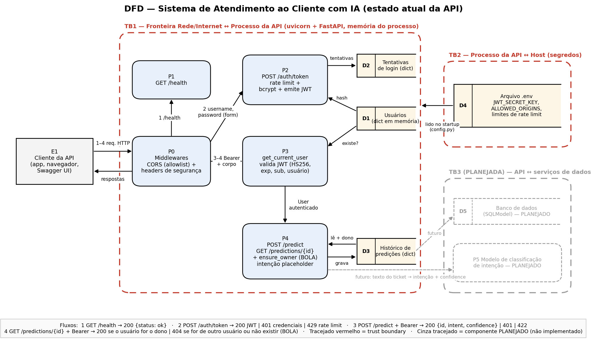
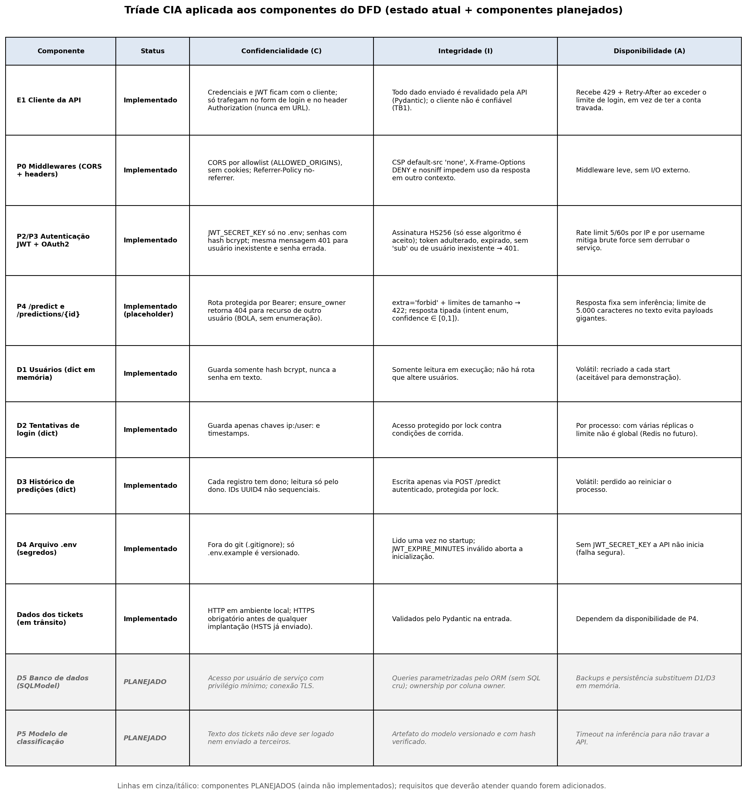

# Sistema de Atendimento ao Cliente com IA — Projeto de Bloco

Sistema de atendimento ao cliente alimentado por inteligência artificial: um agente que recebe a
mensagem de um cliente e infere a **intenção** por trás dela (problema técnico, cobrança, dúvida de
produto, reembolso, cancelamento). Ao final do bloco, o sistema construído será também **atacado**
(red team) para descobrir falhas de segurança — por isso a API já nasce com autenticação JWT.

## Estado atual (TP3)

| Etapa | Status |
|---|---|
| 1. Documentação técnica do dataset | ✅ Concluída (abaixo e no notebook) |
| 2. EDA completo (etapas 1.1–1.8: inspeção, qualidade, limpeza, univariada, multivariada, outliers, documentação) | ✅ Concluída — `eda/eda.ipynb` |
| 3. Hipóteses sobre as intenções dos usuários | ✅ Concluída — 5 exploratórias + 6 testes formais (Mann-Whitney e qui-quadrado) no notebook |
| 4. API FastAPI + JWT (`/health`, `/auth/token`, `/predict`, `/predictions/{id}`) | ✅ Estrutura inicial — `fastapi/` (responsabilidades dos módulos e contrato de `/predict` documentados abaixo) |
| 5. DFD com trust boundaries + tríade CIA | ✅ Concluída — `others/` (alinhados à implementação atual, trust boundaries nomeadas TB1–TB3) |
| 6. Hardening OWASP Top 10 na API (headers, CORS, rate limit, `extra=forbid`) | ✅ Concluída — `fastapi/SECURITY.md` |
| 7. Testes de segurança automatizados (pytest) | ✅ Concluída — `tests/test_security.py` (22 testes) |
| 8. Scan passivo com OWASP ZAP (findings médio/alto) | ✅ Concluída — `zap/` |
| 9. TP3 · Tarefa 1 — regressão linear (pipeline completo, R²/RMSE, residual plot, Q-Q plot, limitações) | ✅ Concluída — `tp3/regressao.ipynb` (executado) |
| 10. TP3 · Tarefa 6 — pergunta de classificação (classes, distribuição, justificativa ML supervisionado) | ✅ Concluída — `tp3/pergunta_classificacao.md` + `.pdf` (2 páginas) |
| 11. Formalização do problema de classificação (X, y, classes, distribuição com tabela e gráfico, classificação × regressão linear com demonstração) | ✅ Concluída — `eda/eda.ipynb`, Seção 12 (executada) |

## Dataset: Customer Support Ticket Dataset

- **Fonte:** [Kaggle — suraj520/customer-support-ticket-dataset](https://www.kaggle.com/datasets/suraj520/customer-support-ticket-dataset)
- **Licença:** CC0: Public Domain (uso livre, inclusive comercial)
- **Arquivo:** `customer_support_tickets.csv` — 8.469 registros × 17 colunas (~3,9 MB)
- **Domínio:** tickets de suporte de produtos de tecnologia (laptops, smartphones, TVs, acessórios)
- **Alvo da classificação de intenção:** `Ticket Type` (5 classes balanceadas: technical issue,
  billing inquiry, product inquiry, refund request, cancellation request)
- **Texto para NLP:** `Ticket Subject` (16 assuntos) e `Ticket Description` (descrição longa)
- **Dimensões de contexto:** cliente (idade, gênero), produto (42), status, prioridade, canal,
  tempos de resposta/resolução, satisfação (1–5)
- **Natureza:** sintética — artefatos de geração identificados no EDA (placeholder
  `{product_purchased}` em 100% das descrições, janela de tickets de ~2,5 dias, resoluções
  anteriores a primeiras respostas em ~49% dos tickets fechados)

**Motivo da escolha:** aderência direta ao objetivo do bloco (texto livre + rótulo de intenção =
matéria-prima de um agente de IA), riqueza de dimensões de contexto, problema multiclasse
balanceado e realista, e licença CC0 compatível com repositório público.

## Estrutura de pastas (estado atual do desenvolvimento)

```
.
├── README.md                          # este arquivo
├── requirements.txt                   # dependências Python
├── .gitignore                         # ignora .venv/, caches e artefatos de kernel
├── data/
│   ├── customer_support_tickets.csv         # dataset original (Kaggle)
│   └── customer_support_tickets_clean.csv   # versão limpa (gerada pela célula de limpeza do EDA)
├── eda/
│   └── eda.ipynb                      # EDA completo — já executado com gráficos embutidos
├── tp3/                               # transição T1 → T2 (TP3)
│   ├── regressao.ipynb                # Tarefa 1: regressão linear (pipeline, R²/RMSE, resíduos, Q-Q)
│   ├── pergunta_classificacao.md      # Tarefa 6: pergunta de classificação (classes, distribuição, justificativa)
│   └── pergunta_classificacao.pdf     # mesma entrega em PDF (2 páginas)
├── fastapi/                           # código-fonte da API (etapas 4 e 6)
│   ├── main.py                        # ponto de entrada (uvicorn main:app --reload)
│   ├── requirements.txt               # dependências da API e dos testes (isoladas das do EDA)
│   ├── .env.example                   # variáveis de ambiente esperadas (JWT_SECRET_KEY, ...)
│   ├── SECURITY.md                    # decisões de hardening OWASP Top 10
│   ├── routes/                        # endpoints: health, auth, predict
│   ├── models/                        # schemas Pydantic de entrada/saída
│   └── security/                      # JWT, OAuth2, headers, rate limit, ownership, usuários
├── tests/
│   ├── conftest.py                    # setup comum: sys.path, env de teste, reset de estado, tokens
│   └── test_security.py               # testes de segurança da API (etapa 7)
├── zap/                               # scan passivo OWASP ZAP (etapa 8)
│   ├── scan_passivo_zap.md            # análise dos findings (severidade média e alta)
│   └── *.pdf                          # relatório bruto do ZAP e versão em PDF da análise
└── others/                            # DFD e CIA em .png (etapa 5)
    ├── CIA.png                        # análise CIA
    └── DFD.png                        # análise DFD
```

## Instalação

**Pré-requisitos:** Python 3.10+, git.

```bash
# 1. Clonar o repositório
git clone <url-do-repositorio>
cd <repositorio>

# 2. Criar ambiente virtual
python3 -m venv .venv
source .venv/bin/activate            # Linux/macOS

# 3. Instalar dependências
pip install -r requirements.txt
```

> O dataset original já está versionado em `data/`. Para (re)baixar da fonte:
> `python -c "import kagglehub; print(kagglehub.dataset_download('suraj520/customer-support-ticket-dataset'))"`

## Execução

### EDA (notebook)

```bash
source .venv/bin/activate
jupyter notebook eda/eda.ipynb
```

O notebook já é entregue executado (saídas e gráficos embutidos). Segue a estrutura pedida no TP:
(1) compreensão do problema e do dataset, (2) inspeção inicial, (3) verificação da qualidade dos
dados, (4) limpeza e preparação, (5) análise univariada, (6) análise multivariada, (7) hipóteses
exploratórias sobre as intenções, (8) identificação de outliers e anomalias, (9) testes de
hipótese formais, (10) documentação do EDA e conclusões, (11) DFD + CIA e (12) formalização do
problema de classificação (X, y, distribuição das classes e por que não regressão linear). Atenção: reexecutar a célula de limpeza
regenera `data/customer_support_tickets_clean.csv` (incluindo as variáveis derivadas).

O notebook do TP3 (`tp3/regressao.ipynb`) segue o mesmo padrão (executado, saídas e gráficos
embutidos) e usa `scikit-learn`, já adicionado ao `requirements.txt` raiz.

### API FastAPI

> **Importante:** todos os comandos abaixo — inclusive o `uvicorn main:app --reload` — devem ser
> executados **dentro do diretório `fastapi/`**. O `main.py` e os pacotes `routes/`, `models/` e
> `security/` usam imports absolutos relativos a essa pasta; rodar o `uvicorn` a partir da raiz
> do repositório falha com `ModuleNotFoundError`/`Could not import module "main"`.

```bash
cd fastapi                     # ← obrigatório: a API roda a partir desta pasta
python3 -m venv .venv
source .venv/bin/activate
pip install -r requirements.txt
cp .env.example .env
python3 -c "import secrets; print(secrets.token_hex(32))"   # gera um valor aleatório
# cole o valor gerado em JWT_SECRET_KEY dentro de .env
uvicorn main:app --reload      # ainda dentro de fastapi/
```

> Também defina `ALLOWED_ORIGINS` (origens de CORS autorizadas) e, opcionalmente,
> `JWT_EXPIRE_MINUTES` e `AUTH_RATE_LIMIT_MAX_ATTEMPTS`/`AUTH_RATE_LIMIT_WINDOW_SECONDS` no
> `.env` — valores padrão e justificativa em [`fastapi/SECURITY.md`](fastapi/SECURITY.md).

#### Organização do código e responsabilidades

A API segue três camadas com responsabilidades separadas: **`routes/`** recebe a requisição HTTP,
**`models/`** define e valida o contrato de dados, **`security/`** concentra todos os controles
de segurança (aplicados nas rotas via `Depends`). Nenhuma rota valida dados ou autentica por
conta própria.

| Módulo | Responsabilidade |
|---|---|
| `main.py` | Cria a app FastAPI, registra os middlewares (CORS, headers de segurança) e inclui os routers. |
| **`routes/`** | **Camada HTTP** — define os endpoints e orquestra a requisição; não contém regras de segurança. |
| `routes/health.py` | `GET /health` — verificação de disponibilidade (pública). |
| `routes/auth.py` | `POST /auth/token` — login OAuth2 *password flow*; aplica rate limit e emite o JWT. |
| `routes/predict.py` | `POST /predict` e `GET /predictions/{id}` — rotas protegidas por JWT; histórico de predições em memória com checagem de dono (BOLA). |
| **`models/`** | **Contrato de dados** — schemas Pydantic de entrada e saída; sem lógica de negócio. |
| `models/base.py` | `StrictBaseModel` (`extra="forbid"`): base de todo corpo de requisição — campo extra → `422`. |
| `models/predict.py` | `Intent` (5 classes), `PredictRequest`, `PredictResponse` — contrato de `/predict` (abaixo). |
| `models/token.py` / `models/user.py` | `Token` (resposta do login) e `User` (usuário autenticado repassado às rotas). |
| **`security/`** | **Controles de segurança** reutilizáveis. |
| `security/config.py` | Configuração central lida do `.env`, em seções: (1) autenticação JWT/OAuth2, (2) CORS, (3) rate limit. Nenhum outro módulo lê `os.getenv`. |
| `security/jwt.py` | Emissão e validação do JWT (HS256, com expiração `exp`). |
| `security/oauth2.py` | `OAuth2PasswordBearer` + `get_current_user`: dependency das rotas protegidas (`401` para token ausente/inválido/expirado). |
| `security/users.py` | Base de usuários **em memória** (dict) e verificação de senha com bcrypt. |
| `security/ownership.py` | `ensure_owner`: `404` quando o recurso pertence a outro usuário (BOLA). |
| `security/rate_limit.py` | Limite de tentativas em `/auth/token` (`429` + `Retry-After`). |
| `security/headers.py` | Middleware de headers de segurança (HSTS, CSP, X-Frame-Options, ...). |

Endpoints disponíveis (docs interativas em `http://127.0.0.1:8000/docs`, onde os schemas abaixo
aparecem com a descrição de cada campo):

- `GET /health` — verificação de disponibilidade, sem autenticação.
- `POST /auth/token` — login (`OAuth2PasswordRequestForm`: `username`/`password`) e emissão de
  token JWT. Usuários de demonstração: `admin` / `admin123` e `analista` / `analista123` (base
  em memória, ver `security/users.py` — trocar por uma base real antes de produção).
- `POST /predict` — protegido por Bearer token; contrato detalhado abaixo.
- `GET /predictions/{prediction_id}` — protegido por Bearer token; retorna uma predição do
  histórico **somente se pertencer ao usuário autenticado** (caso contrário, `404` — BOLA).

#### Contrato de `POST /predict`

**Requisição** — header `Authorization: Bearer <token>` e corpo JSON (`PredictRequest`, sem
campos extras):

| Campo | Tipo | Regras | Significado |
|---|---|---|---|
| `ticket_subject` | string | obrigatório, 1–200 caracteres | Assunto do ticket (coluna `Ticket Subject`). |
| `ticket_description` | string | obrigatório, 1–5000 caracteres | Texto livre do cliente (coluna `Ticket Description`). |

**Resposta `200`** (`PredictResponse`):

| Campo | Tipo | Significado |
|---|---|---|
| `id` | string (UUID4) | Identificador da predição no histórico do usuário; use em `GET /predictions/{id}`. |
| `intent` | enum | Intenção prevista — uma das 5 classes de `Ticket Type`: `Technical issue`, `Billing inquiry`, `Product inquiry`, `Refund request`, `Cancellation request`. |
| `confidence` | float em [0, 1] | **Probabilidade** que o modelo atribui à classe em `intent` (ex.: saída `softmax`/`predict_proba`). Com 5 classes balanceadas, ≈ 0,2 equivale a um palpite aleatório. |

**Estado atual — placeholder:** o modelo de classificação **ainda não está integrado**. A API
devolve sempre `intent = "Technical issue"` com `confidence = 0.0`. O `0.0` é **proposital**: não
significa "0 % de chance de ser Technical issue", e sim "não houve inferência" — a intenção
retornada é fixa e **não deve ser usada para nenhuma decisão**. Quando o modelo for integrado,
`confidence` passará a trazer a probabilidade real e o contrato (nomes, tipos e intervalos dos
campos) permanece o mesmo. Esse comportamento é coberto pelo teste
`test_predict_placeholder_contract`.

```json
// POST /predict
{"ticket_subject": "Product setup", "ticket_description": "I can't connect my device to the Wi-Fi network."}
// 200 OK (placeholder)
{"id": "3f2b1c9e-...", "intent": "Technical issue", "confidence": 0.0}
```

**Erros:** `401` token ausente, inválido ou expirado · `422` corpo inválido (campo ausente,
vazio, longo demais, tipo errado ou campo extra).

#### Autenticação (JWT + OAuth2PasswordBearer)

1. `POST /auth/token` com `username`/`password` (form) → senha conferida com bcrypt → JWT HS256
   com `sub` (usuário) e `exp` (expira em `JWT_EXPIRE_MINUTES`, padrão 30).
2. Rotas protegidas declaram `Depends(get_current_user)`; o `OAuth2PasswordBearer` extrai o token
   do header `Authorization: Bearer`, e `get_current_user` valida assinatura, algoritmo,
   expiração, presença de `sub` e existência do usuário. Qualquer falha → `401` com
   `WWW-Authenticate: Bearer`.
3. Toda a configuração de autenticação (rota de emissão do token, algoritmo, segredo, expiração)
   fica na seção 1 de `security/config.py` — o router de login e o `OAuth2PasswordBearer` usam a
   mesma constante `AUTH_TOKEN_URL`, então não podem divergir.

### Testes de segurança

Com o ambiente da API ativado (`fastapi/.venv`, que já inclui `pytest` e `httpx`), a partir da
raiz do repositório:

```bash
source fastapi/.venv/bin/activate
pytest tests/ -v
```

Os testes não dependem do `.env`: `tests/conftest.py` define `JWT_SECRET_KEY` e os limites de
rate limit antes de importar a app e zera o estado em memória (rate limit e histórico de
predições) antes de cada teste. Resultado atual: **22 passed**.

| Aspecto | Teste(s) em `tests/test_security.py` | Esperado |
|---|---|---|
| Autenticação | `test_login_with_valid_credentials_returns_bearer_token` | `200` + `access_token`, `token_type=bearer` |
| | `test_login_with_invalid_credentials_returns_401` (senha errada / usuário inexistente) | `401`, mesma mensagem nos dois casos |
| Autorização / BOLA | `test_owner_can_read_own_prediction` | `200` para o dono |
| | `test_user_cannot_read_prediction_of_another_user` | `404` ao ler predição de outro usuário |
| | `test_bola_response_is_indistinguishable_from_missing_resource` | resposta idêntica a ID inexistente (sem enumeração) |
| Validação de entrada | `test_predict_rejects_extra_body_field` | `422` `extra_forbidden` (mass assignment) |
| | `test_predict_rejects_invalid_input` (ausente, vazio, > 200 chars, tipo errado) | `422` apontando o campo |
| | `test_predict_accepts_valid_input` | `200` com apenas `id`/`intent`/`confidence` |
| | `test_predict_placeholder_contract` | contrato do placeholder: `Technical issue` com `confidence = 0.0` |
| Rate limiting | `test_login_rate_limit_returns_429_after_limit` | 5× `401`, 6ª tentativa `429` + `Retry-After: 60` (mesmo com senha correta) |
| Rota protegida — token **ausente** | `test_predict_without_token_returns_401`, `test_get_prediction_without_token_returns_401` | `401` `Not authenticated` + `WWW-Authenticate: Bearer` |
| Rota protegida — token **inválido** | `test_predict_with_invalid_token_returns_401` (malformado / assinatura forjada) | `401` |
| | `test_predict_with_alg_none_token_returns_401` (`"alg": "none"`, sem assinatura) | `401` |
| | `test_predict_with_token_without_sub_returns_401`, `test_predict_with_token_for_unknown_user_returns_401` | `401` |
| Rota protegida — token **expirado** | `test_predict_with_expired_token_returns_401` | `401` |

**Alterações na API feitas para viabilizar os testes:**
nova rota `GET /predictions/{prediction_id}` com checagem de ownership (BOLA), campo `id` na
resposta de `POST /predict`, segundo usuário de demonstração (`analista` / `analista123`) e
renomeação de `tests/test.py` → `tests/test_security.py` (o nome antigo não era coletado pelo
pytest).

## Scan passivo OWASP ZAP (resumo)

Scan passivo da API local (`http://127.0.0.1:8000`) com OWASP ZAP. Análise completa em
[`zap/scan_passivo_zap.md`](zap/scan_passivo_zap.md) e relatório bruto em `zap/`.

| Finding | Severidade | Onde | Tratamento |
|---|---|---|---|
| Authentication Credentials Captured | High | `/auth/token` | HTTP apenas em ambiente local; HTTPS obrigatório antes de qualquer implantação |
| Content Security Policy Header Not Set | Medium | `/docs` | Risco aceito em desenvolvimento; CSP recomendada se `/docs` for exposto |
| Cross-Domain Misconfiguration | Medium | CDN jsDelivr (Swagger UI) | Risco de terceiro — o CORS da própria API é restritivo (`ALLOWED_ORIGINS`) |
| Sub Resource Integrity Attribute Missing | Medium | `/docs` (Swagger UI) | Risco aceito enquanto `/docs` não for público em produção |

## Hipóteses sobre as intenções dos usuários (resumo)

1. **Intenções equilibradas** — 5 classes entre 19,3% e 20,7%: não há intenção dominante;
   classificador multiclasse balanceado (baseline ≈ 20%).
2. **Prioridade não reflete intenção real de urgência** — ~50% dos tickets `High`/`Critical`
   vs. 33% fechados: urgência declarada é inflada/aleatória.
3. **Contato majoritariamente textual e digital** — ~75% por Email/Chat/Social media: valida
   agente baseado em NLP sobre texto.
4. **A intenção depende do tipo de problema, não do produto** — 42 produtos, top-1 ≈ 2,8%:
   o modelo generaliza sem features de produto.
5. **Texto bruto insuficiente para inferir intenção** — 100% das descrições com placeholder e
   ~69% em template fixo: risco de overfitting lexical; usar `Subject`/`Type` como sinal central.

Detalhamento completo, com as estatísticas que sustentam cada hipótese, no notebook
(`eda/eda.ipynb`, Seção 7).

## Testes de hipótese formais (resumo)

As hipóteses foram submetidas a testes formais (α = 0,05, Seção 9 do notebook). Como as
numéricas violam normalidade (Shapiro p < 1e−4; idade uniforme; satisfação ordinal), as
comparações usam **Mann-Whitney U** (com t de Welch como robustez) e os testes de
uniformidade/independência usam **qui-quadrado**:

| Hipótese | Teste | p | Conclusão |
|---|---|---|---|
| H1 · Satisfação de `Technical issue` < `Billing inquiry` | Mann-Whitney (unilateral) | 0,208 | Não rejeita H0 (efeito +0,03) |
| H2 · Usuários de Chat mais jovens que de Phone | Mann-Whitney (unilateral) | 0,351 | Não rejeita H0 (efeito +0,01) |
| H3 · Duração da resolução difere Phone × Email | Mann-Whitney (bilateral) | 0,230 | Não rejeita H0 (efeito +0,04) |
| H4 · Satisfação difere entre prioridades alta × baixa | Mann-Whitney (bilateral) | 0,418 | Não rejeita H0 (efeito +0,02) |
| H5 · Hora da 1ª resposta é uniforme | χ²(23) de aderência | **0,026** | **Rejeita H0** — leve pico às 19h |
| H6 · `Ticket Subject` ⊥ `Ticket Type` | χ²(60) de independência | 0,981 | Não rejeita H0 — **rótulos independentes** |

**Interpretação:** os quatro testes de comparação têm efeitos desprezíveis (|rank-biserial| ≤
0,04) — prioridade, canal e idade não carregam sinal, confirmando formalmente a natureza
sintética do dataset. As duas estruturas detectadas são artefatos (pico vespertino dentro de uma
janela de 2,5 dias; independência total entre as duas camadas de rótulo). Implicação para a
modelagem: **não usar `Ticket Subject` como preditor de `Ticket Type`** e não confiar em
metadados — o modelo deve apoiar-se no texto normalizado da descrição.

## TP3 — consolidação e transição para o Trimestre 2 (resumo)

O TP3 encerra o Trimestre 1 e prepara o Trimestre 2 — ver `tp3/regressao.ipynb` (Tarefa 1) e
`tp3/pergunta_classificacao.md` (Tarefa 6).

**Tarefa 1 — regressão linear (consolidação).** Alvo: `Desc_Len` (comprimento do texto, derivado
no EDA e disponível para os 8.469 tickets). Pipeline completo (imputação + one-hot + padronização
+ `LinearRegression`, 32 preditores), R² e RMSE em treino/teste e validação cruzada 5-fold,
comparado a baseline que prevê a média. Resultado: **R² ≈ 0 no teste (−0,0002; RMSE = 44,7 ≈ σ)**
e desempenho **abaixo do baseline na CV** — os metadados não carregam sinal linear (η² máximo
0,001), confirmando o EDA. Resíduos: residual plot sem forma, Q-Q plot com desvio nas caudas e
Shapiro-Wilk p = 2,9e−28 — violação de normalidade esperada de um alvo truncado (135–402) e
sintético. Limitações e próximos passos na Seção 8 do notebook.

**Tarefa 6 — pergunta de classificação.** *"Dado um texto de atendimento ao cliente, qual é a
intenção do usuário?"* — classificação supervisionada multiclasse sobre texto, com 5 classes
(`Technical issue`, `Billing inquiry`, `Product inquiry`, `Refund request`, `Cancellation
request`) balanceadas (19,3%–20,7%; baseline aleatório ≈ 20%). A regressão linear não se aplica
(rótulos nominais sem ordem; saída contínua ≠ probabilidade); o plano do T2 usa TF-IDF +
regressão logística multinomial/Naive Bayes/SVM, com F1 macro como métrica principal e
integração no `/predict` já auditado.

## DFD



**Trust boundaries:**

| ID | Fronteira | O que cruza | Controles na fronteira |
|---|---|---|---|
| **TB1** | Rede/Internet ↔ Processo da API (uvicorn + FastAPI) | Requisições HTTP do cliente (credenciais, JWT, texto dos tickets) | CORS por allowlist, headers de segurança, rate limit no login, validação Pydantic (`extra=forbid`), JWT em toda rota protegida, `ensure_owner` (BOLA) |
| **TB2** | Processo da API ↔ Host (arquivo `.env`) | Segredos e configuração (`JWT_SECRET_KEY`, `ALLOWED_ORIGINS`, limites) lidos no startup | `.env` fora do git; sem `JWT_SECRET_KEY` (ou com expiração inválida) a API não inicia |
| **TB3** *(planejada)* | Processo da API ↔ serviços de dados (banco SQLModel, modelo de classificação) | Futuro: persistência de usuários/predições e inferência | Futuro: queries parametrizadas, usuário de banco com privilégio mínimo, TLS |

Os depósitos `D1`–`D3` estão **dentro** de TB1 porque vivem na memória do mesmo processo — não há
fronteira de rede entre a API e eles.

## CIA



A tabela aplica a tríade CIA a cada componente do DFD, usando os mesmos identificadores
(`E1`, `P0`–`P4`, `D1`–`D4`). As linhas de **componentes implementados** descrevem controles que
existem no código; as duas últimas linhas (`D5` banco de dados e `P5` modelo de classificação),
em cinza/itálico e marcadas como **PLANEJADO**, descrevem requisitos que esses componentes deverão
atender quando forem adicionados — não são controles existentes.

## Licença

- Dataset: CC0: Public Domain.
- Código deste repositório: para fins acadêmicos do Projeto de Bloco.
